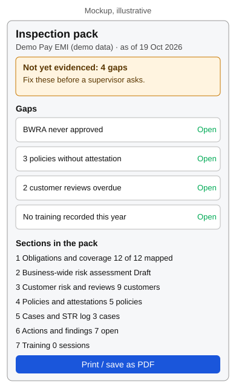

## Problem
When a supervisor asks "show me your AML framework", a one-person team
has to open the obligations register, controls, BWRA, customer risk,
policies, cases, actions and Academy training one by one, screenshot
each, and hope the numbers agree. Each RegRadar module already prints or
exports on its own, but nothing assembles them into one dated, coherent
document, and nothing shows what is missing before the request arrives.

## Why now
AMLR applies from 10 July 2027 (see `obligations.json`), and AMLA is
finalising the RTS that define what CDD evidence looks like. Teams will
be asked to show their readiness before then. Sources:
- AMLA consultation launch (9 Feb 2026, CDD RTS open to 8 May 2026):
  https://finreg.aoshearman.com/eu-amla-launches-suite-of-consultation-papers-on-draft-rts-under-eu-aml-package
- AMLA draft RTS on CDD overview:
  https://hlc.com/en/publications/amla-consults-on-draft-rts-on-customer-due-diligence-and-harmonized-supervision

## Idea
An "Inspection pack" view inside Compliance. It reads the device-local
data each module already keeps (BWRA, CRA, policies, controls, actions,
cases, Academy progress) and builds one print-ready page with a cover
(firm name, as-of date, "prototype, not legal advice"), a one-line
status per section, and a "Not yet evidenced" list at the top: for
example "BWRA never approved", "3 policies without attestation",
"2 customer reviews overdue", "no training recorded this year". Each line
links to the module that fixes it. Print to PDF gives the binder.

## Smallest prototype
A static lab page `docs/labs/001-inspection-pack/` with a readiness
checklist of 8 sections and a print stylesheet. It reads the real
`localStorage` keys when present and otherwise falls back to clearly
labelled demo data, so it can be judged in five minutes on a phone.
No edits to existing modules.

## Risks and open questions
- Each module's storage shape can change; the pack must degrade to
  "no data" per section rather than fail.
- What counts as "evidenced" is a judgement; defaults must be labelled
  "default, configure for your firm" and reviewed by the owner.
- Overlaps the backlog item "printable coverage statement"; this idea
  would absorb it as one section.

## How we would know it works
A tester can go from an empty browser to a printed pack with a
non-empty "Not yet evidenced" list in under five minutes, and every
listed gap links to the right module.
