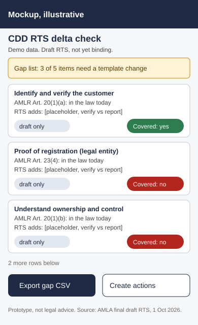

## Problem
AMLA has now sent its final draft CDD standards to the Commission. A
one-person team must work out, line by line, what the standards add to
the AMLR text their onboarding checklist already follows, then decide
what to change in templates and what to re-collect on existing files.
Today that is a PDF read plus a hand-built spreadsheet. RegRadar already
has the onboarding checklist (`cra-checklist.json`), each item tied to a
verbatim AMLR article, so the comparison can happen right next to it.

## Why now
- AMLA submitted its final draft CDD RTS to the Commission on 1 October
  2026 (consultation ran 9 Feb to 8 May 2026). The Commission then has
  three months to decide whether to adopt them, in part or with
  amendments (Art. 49 AMLA Regulation, as reported by the sources below).
  So the text is not binding yet, which is the moment to prepare.
- AMLR applies from 10 July 2027. Sources disagree on how the RTS
  application date relates to that, so the idea must not assert one.
- Sources:
  https://www.regulationtomorrow.com/2026/10/amla-finalises-key-standards-for-the-private-sector/
  https://finreg.aoshearman.com/amla-publishes-three-sets-of-final-draft-rts-under-eu-aml-package
  https://finreg.aoshearman.com/eu-amla-launches-suite-of-consultation-papers-on-draft-rts-under-eu-aml-package

## Idea
A "Delta check" view in the Customer risk / onboarding checklist. For
each checklist item it shows three things side by side: what the AMLR
article says (already in the data), what the draft RTS adds (a short
owner-reviewed note with article reference), and one switch: "my
template already covers this". The page ends with a dated gap list
("7 of 12 items need a template change") that exports to CSV and can
become actions in the existing Actions tracker. A status chip per row:
RTS confirmed in force / draft only / not yet in force, so nothing
reads as binding before it is.

## Smallest prototype
Static lab page `docs/labs/002-rts-delta-check/` with 8 checklist rows
read from the real `cra-checklist.json`, a demo "RTS adds" column
clearly marked as placeholder text to be verified against the final
report, covered/not-covered toggles kept in localStorage, a gap counter
and CSV export. Judgeable on a phone in five minutes.

## Risks and open questions
- The "RTS adds" notes are legal content: the owner (or a reviewer)
  must verify each against the final report before they go beyond demo.
  The prototype uses placeholders, never invented requirements.
- The text may change when the Commission adopts it; every row needs a
  version/date and the chip above.
- Overlaps RegWatch change tracking (backlog B) only loosely: this is a
  one-off preparation view for one regulation, not a general feed.

## How we would know it works
A tester can open the page, mark which items their template covers, and
export a gap list in under five minutes, and every row links to the
AMLR article it extends.
